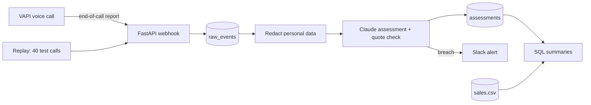

# Sales call QA

Automated QA for life insurance sales calls: Claude checks every call against a compliance rubric, quotes the evidence, and flags breaches for a person to review.

**[▶ 5-minute walkthrough on Loom](https://www.loom.com/share/d12948276d1e4fd08b4ffb1d61ef9dd1)**: a breach caught and sent to Slack, the pipeline behind it, and how it was measured.

| Set-up | Breaches caught (recall) | Flags that were real (precision) | Quotes verified | Cost per call | Seconds per call |
|---|---|---|---|---|---|
| **Claude Haiku 5.5, prompt v2 (chosen)** | **100%** (38/38) | **83%** (38/46) | 98% | $0.0015 | 9.8 |

Measured on 40 fake calls with 38 planted breaches. The full comparison is under [Results](#results).

## Why

Checking sales calls by hand doesn't scale. Reviewers can only sample a small share of calls, so most breaches are never seen. This checks every call, and every verdict quotes the words it's based on, so a reviewer can confirm it in seconds instead of listening to the whole recording.

## How it works



1. **Webhook** ([api.py](src/sales_call_qa/api.py)): VAPI posts an end-of-call report. The endpoint checks a shared secret in constant time, ignores other message types, replies straight away and assesses in the background, so VAPI never waits on the model.
2. **Store the raw payload** ([pipeline.py](src/sales_call_qa/pipeline.py)): untouched, in `raw_events`, keyed on the call ID. `ON CONFLICT DO NOTHING` makes a repeated delivery harmless.
3. **Convert** ([vapi.py](src/sales_call_qa/vapi.py)): VAPI's messages become the transcript format the assessor uses.
4. **Redact** ([redact.py](src/sales_call_qa/redact.py)): names, dates of birth, phone numbers, emails and card numbers become placeholders such as `<PERSON>` before anything reaches the model or the cleaned `calls` table.
5. **Assess** ([assess.py](src/sales_call_qa/assess.py)): one Claude call per sales call returns a verdict for each rubric item (pass, fail or n/a) with an exact quote, its timestamp and a one-line reason. Rules that code already knows, such as an Australia-only item, are filled in by code rather than the model.
6. **Check every quote**: code confirms each quote really appears in the redacted transcript. A quote that can't be found is saved with `evidence_verified = false` and flagged, not silently retried.
7. **Store and alert**: the run (model, prompt version, tokens, seconds) and its eight verdicts go to Postgres, every call ends `assessed` or `failed` with its error, and any breach is posted to Slack with the agent's quoted words.
8. **Report** ([sql/](sql/)): hand-written SQL joins verdicts to sales data.

## Results

### Model comparison

| Run | Recall | Precision | n/a accuracy | Quotes verified | Cost per call | Seconds per call |
|---|---|---|---|---|---|---|
| Haiku 5.5, v1 | 100% (38/38) | 59% (38/64) | 87% | 98% | $0.0016 | 10.6 |
| Sonnet 5.5, v1 | 97% (37/38) | 70% (37/53) | 91% | 100% | $0.0162 | 6.4 |
| Haiku, with Sonnet re-checking the calls Haiku flags, v1 | 97% (37/38) | 71% (37/52) | 91% | 100% | $0.0151 | 16.8 |
| **Haiku 5.5, v2** | **100%** (38/38) | **83%** (38/46) | 90% | 98% | $0.0015 | 9.8 |

Recall matters most here: a missed breach is the expensive mistake. Precision matters next: too many false alarms and reviewers stop trusting the flags. Costs use Anthropic's list prices as of October 2026.

### By rubric item (Haiku, v1 → v2)

| Rubric item | Recall v1 | Recall v2 | Precision v1 | Precision v2 |
|---|---|---|---|---|
| recording_disclosure | 100% | 100% | 100% | 100% |
| identity_check | 100% | 100% | 100% | 100% |
| needs_assessment | 100% | 100% | 100% | 100% |
| accurate_product_info | 100% | 100% | **26%** | **100%** |
| no_pressure_selling | 100% | 100% | 50% | 62% |
| explicit_consent | 100% | 100% | 100% | 100% |
| vulnerability_handling | 100% | 100% | 42% | 50% |
| general_advice_warning | 100% | 100% | 100% | 100% |

### What changed between v1 and v2

Haiku v1 caught every breach but raised 26 false alarms. Reading them showed that 14 came from `accurate_product_info`: Haiku failed anything the product facts didn't *mention*, such as the premium quoted to that customer, and counted "this rate is only available on this call" as a product error as well as pressure. v2 adds one line to the prompt: only a statement that *contradicts* the facts is a breach, and pressure tactics belong under `no_pressure_selling`. That item's precision went from 26% to 100% and overall precision from 59% to 83%, with recall still at 100%.

### Why Haiku, not Sonnet

Sonnet was more precise on v1 but missed a vulnerability breach that Haiku caught (a customer with memory difficulties after a stroke), and costs ten times as much. Routing Haiku's flags to Sonnet saved only 7%, because Haiku flagged 33 of the 40 calls. Improving Haiku's precision is what would make routing worthwhile, since fewer calls would be escalated.

Run `uv run evaluate` (or `--version v2`) to regenerate these tables and list every disagreement with the answer key, with the model's reason.

## Decisions and trade-offs

| Decision | Why | Trade-off |
|---|---|---|
| Fake calls with breaches planted in code | The answer key exists before Claude writes a word, and runs repeat exactly from a seed | Fake calls are cleaner than real ones; reviewed real calls would replace them as the test set |
| Structured output with the Anthropic SDK (`messages.parse` into Pydantic) | One thin layer over the API, validated against the schema, with retries for cut-off output, refusals and missing rubric items | Comparing many providers would be easier through a framework |
| Quotes checked in code, flagged rather than retried | The model can't invent evidence unnoticed, and how often it tries stays visible as a number | Matching forgives formatting (quote style, spacing, case) but not changed words; fuzzy matching would trade some strictness for fewer flags |
| Haiku with prompt v2 | Best recall at a tenth of Sonnet's cost; see [Results](#results) | Its remaining false alarms are in vulnerability and pressure selling |
| Redact before calling the model | Only the data the model needs leaves the system | Redaction can remove useful facts: Presidio's date detector blanked "12 months" and "30-day", so a narrower date-of-birth pattern replaced it |
| Names on the call always redacted, case-sensitively | Presidio's language model missed "g'day Jack"; matching the known names closes that gap, and case-sensitivity stops a customer called May wiping out every "may" | A capitalised "May I ask…" is still redacted for a customer called May; over-redacting is the safe direction |
| Secret header with a constant-time compare | Rejects anyone but VAPI without leaking timing information. Both `Authorization: Bearer` and `X-Vapi-Secret` are accepted, since VAPI's setup options can send either; logging header names (never values) on a rejected request showed a live call arriving with an empty `X-Vapi-Secret` until a Bearer token credential was attached | A shared secret proves the sender knows it, not that the body is unchanged; VAPI's HMAC signatures would |
| Reply at once, assess in a background task | VAPI shouldn't wait on a model call, and a slow reply triggers retries | Background tasks are lost if the server restarts; real volume needs a queue (Celery and Redis, for example) |
| Raw payload kept untouched, cleaned rows redacted | An audit trail of exactly what arrived, and the ability to reprocess it | `raw_events` holds unredacted text, so it needs tighter access and a retention limit than `calls` |
| Postgres and hand-written SQL | Raw → cleaned → summary tables, with upserts and window functions | Their platform is Databricks; the mapping is below |

## How this maps to Databricks and n8n

- `raw_events` → `calls` → the SQL summaries are the bronze, silver and gold layers.
- Postgres `INSERT … ON CONFLICT` is the same idea as Delta's `MERGE`.
- The FastAPI webhook could be an n8n webhook node, with the assessment staying in tested Python either way.
- QA doesn't need to be real-time, so on Databricks it could run as a nightly batch job, and Claude's Batch API halves the cost.

## Limitations

- **The calls are fake.** They're cleaner than real calls, there are only 40, and the brand, products and rubric are made up (not legal advice).
- **The cancellation pattern is planted.** The generator makes badly sold policies more likely to be cancelled, so `sql/cooling_off.sql` shows the question to ask of real data, not a finding.
- **Small numbers.** Weekly breach rates and agent rankings rest on one to seven calls each, so one call moves them a lot. The rolling average counts rows, not calendar weeks, so a week with no calls is skipped rather than counted as zero.
- **Redaction is uneven.** Presidio missed the Māori name *Rawiri* in some turns of one call. The model then quoted that name in a line where it had been redacted, and the quote check flagged it. On a live call the customer's name isn't known in advance, so only the language model's guesses apply.
- **Short calls are over-flagged.** A test call that ended before the customer gave their date of birth was marked as an identity-check breach, though nothing had been discussed.
- **Redaction affects one rubric item.** The model sees `<PERSON>`, so it can't always tell whether a customer gave their *full* name for the identity check.
- **v2's wording lets "not mentioned" pass.** An agent who invented a benefit the product facts don't cover would no longer be flagged under `accurate_product_info`.
- **Failed calls aren't retried automatically,** and voice-agent test calls are stored alongside real ones (the agent ranking excludes them).
- **The exchange rates are illustrative** (October 2026); a real report would use the rate on the day of sale.

## What I'd do next with real data

- Replace the made-up rubric with the criteria the compliance team already uses, have reviewers label a sample of real calls against them, and re-measure recall and precision per item.
- Agree with compliance whether money worries alone count as vulnerability; it's where most remaining false alarms are, and it's a rubric question before it's a model question.
- Add a review step where reviewers agree with or overturn each flag, and feed overturned verdicts back as new labels.
- Strengthen redaction with names mentioned during the call and a test set of names from every market, and switch the webhook to HMAC signatures.
- Retry failed calls from a queue, and run the nightly batch through the Batch API.

## What I learned

- **The evaluation surprised me.** I expected the problem to be missed breaches. It was false alarms: Haiku caught every breach but flagged 26 that weren't there. Reading the disagreements, rather than just the score, is what showed me the cause and the one-line fix.
- **A bigger model isn't automatically better.** Sonnet was more precise but missed a breach Haiku caught, at ten times the cost.
- **"Exact quotes" from a model need checking.** Claude rewrote a redacted name back into a "verbatim" quote. Without the check in code, I'd never have known.
- **Redaction is a trade-off, and it's uneven.** It blanked "12 months" and "30-day" until I narrowed it, missed casual names like "g'day Jack", and recognised a Māori name less reliably than English ones. In a market like New Zealand, that's a fairness problem as well as a technical one.
- **VAPI from scratch.** Setting up the voice agent, the webhook and a tunnel took an afternoon. The tricky part wasn't the code but the plumbing: another service on my laptop was already using the port, and a live call arrived with an empty secret header until I attached a credential in VAPI. Logging the header names, never the values, showed me what was actually arriving.
- **The rules belong to compliance, not the engineer.** My rubric is made up. With real data, the first step is their criteria and their reviewers' labels; the rubric is just data, so swapping it in doesn't change the pipeline.

## How I built it

I built it over a weekend with Claude Code as a pair programmer, working from a written plan with a "done when" check for each step.
- **I wrote much of the core myself,** with Claude explaining concepts and reviewing my code: loading calls, building the prompt from the rubric and product facts, adapting the API call and its error handling from the generator, and typing out and debugging the SQL. For other parts, such as the evaluation script and the quote check, Claude wrote the code and walked me through it step by step until I could explain each decision.
- **I tested each step before moving on,** with a checkpoint I could run, and every change is in a small commit, with secret scanning on each one.
- **Where I pushed back: **I spotted the "g'day Jack" name the redaction missed, which led to always redacting the known names on a call. And when claude suggested having compliance label real calls, it also assumed the rubric I used was real, when it had been faked based on assumptions in insurance sells. The rubric also needs to be validate by real QA. That changed how I describe the next step.

## How to run it

Needs Python 3.13, [uv](https://docs.astral.sh/uv/), Docker, and gitleaks (`brew install gitleaks`).

```bash
uv sync
cp .env.example .env              # add ANTHROPIC_API_KEY, VAPI_WEBHOOK_SECRET and (optional) SLACK_WEBHOOK_URL
uv run pre-commit install         # gitleaks blocks any commit containing a secret
uv run pytest
```

**Test data** (already in `data/`; regenerating needs an API key):

```bash
uv run generate-calls --dry-run   # the plan for each call: market, outcome, planted breaches
uv run generate-calls             # writes data/calls/, data/labels.csv and data/sales.csv
```

**Evaluate** (results are already in `data/assessments/`):

```bash
uv run assess-calls --model claude-haiku-5-5    # skips calls already assessed for this model and prompt
uv run evaluate --version v2                     # the tables above, plus every disagreement
```

**The pipeline:**

```bash
docker run --name qa-postgres -e POSTGRES_PASSWORD=postgres -p 5433:5432 -d postgres:17
docker exec -i qa-postgres psql -U postgres < sql/schema.sql
docker exec -i qa-postgres psql -U postgres -c "COPY sales FROM STDIN WITH (FORMAT csv, HEADER true)" < data/sales.csv
docker exec -i qa-postgres psql -U postgres -c "INSERT INTO fx_rates VALUES ('AUD', 1), ('GBP', 1.95), ('CAD', 1.10), ('NZD', 0.91)"

uv run uvicorn sales_call_qa.api:app --port 8001    # the webhook
uv run python -m sales_call_qa.replay               # in another terminal: the 40 test calls, through the webhook
docker exec -i qa-postgres psql -U postgres < sql/breach_rates.sql
docker exec -i qa-postgres psql -U postgres < sql/checks.sql   # every check should return no rows
```

For a live call, expose port 8001 with a tunnel such as Pinggy (`ssh -p 443 -R0:127.0.0.1:8001 a.pinggy.io`), set the VAPI assistant's Server URL to the tunnel address plus `/webhooks/vapi`, attach the secret as a Bearer token credential, and tick End Of Call Report.

## Project layout

| Path | What it does |
|---|---|
| [src/sales_call_qa/rubric.py](src/sales_call_qa/rubric.py) | The 8 rubric items: what a compliant agent does, and what a breach looks like |
| [src/sales_call_qa/markets.py](src/sales_call_qa/markets.py) | AU, UK, CA and NZ: currency, time zone and the made-up product facts |
| [src/sales_call_qa/generate_calls.py](src/sales_call_qa/generate_calls.py) | The fake-call generator with planted breaches and an answer key |
| [src/sales_call_qa/redact.py](src/sales_call_qa/redact.py) | Removes personal data before the model or the cleaned tables see it |
| [src/sales_call_qa/assess.py](src/sales_call_qa/assess.py) | The assessor, the quote check, and `assess-calls` |
| [src/sales_call_qa/evaluate.py](src/sales_call_qa/evaluate.py) | Scores saved assessments against the answer key |
| [src/sales_call_qa/api.py](src/sales_call_qa/api.py), [pipeline.py](src/sales_call_qa/pipeline.py), [vapi.py](src/sales_call_qa/vapi.py) | The webhook and what happens to each arriving call |
| [src/sales_call_qa/alerts.py](src/sales_call_qa/alerts.py) | The Slack alert |
| [src/sales_call_qa/replay.py](src/sales_call_qa/replay.py) | Sends the test calls through the webhook in VAPI's format |
| [sql/](sql/) | The schema, the reporting queries and the data checks |
| [tests/](tests/) | 30 tests; none call the API |
